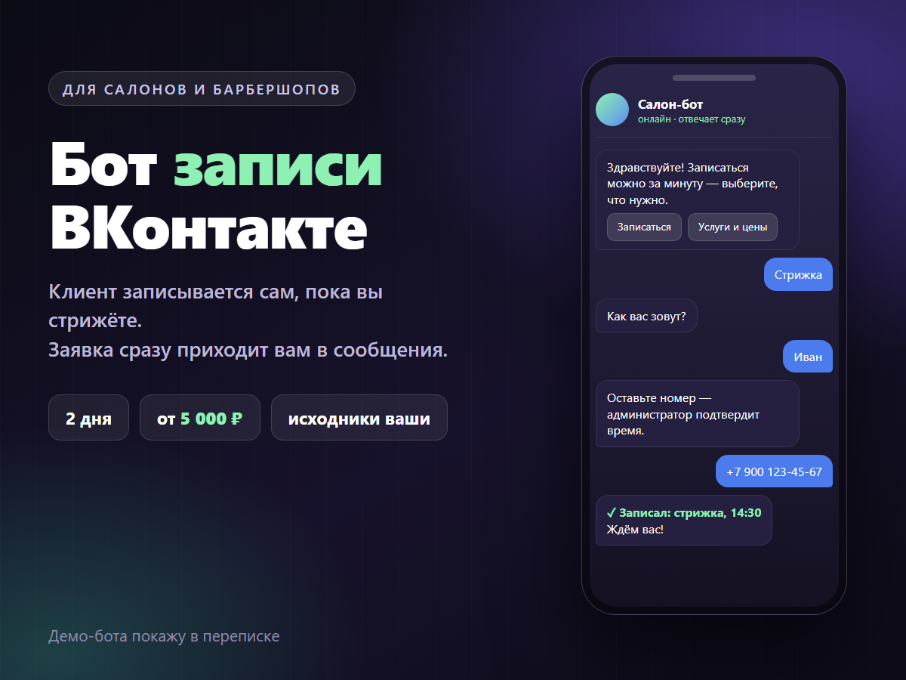
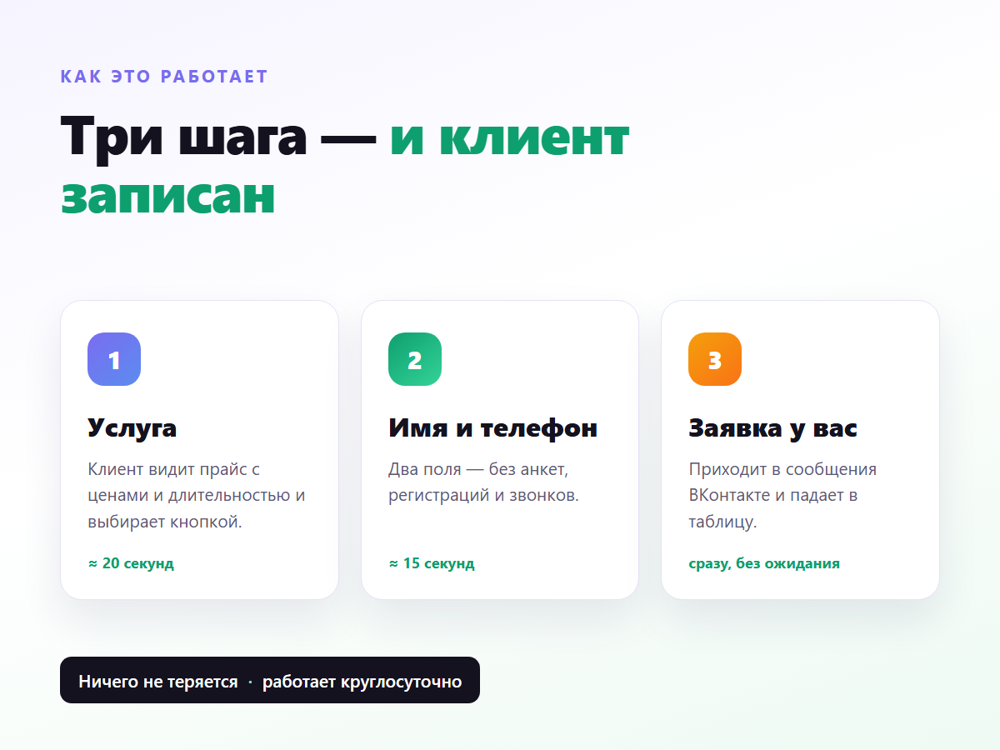
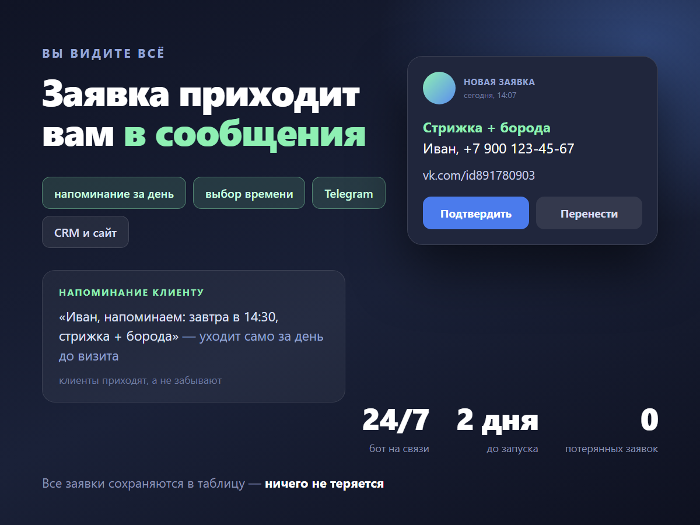

# Бот записи для салона ВКонтакте

Готовый шаблон чат-бота для салона красоты, барбершопа, маникюра или клиники:
прайс, запись клиента в три шага, согласие на обработку персональных данных
(152-ФЗ) и уведомление администратору в личные сообщения.



## Что умеет

- **Меню и прайс.** Клиент видит услуги, цены и длительность одной кнопкой.
- **Запись в три шага.** Услуга → имя → телефон, без анкет и регистрации.
- **Согласие 152-ФЗ.** Бот показывает текст согласия до запроса номера и пишет
  `consent_152fz: true` в саму заявку.
- **Заявка не теряется.** Сохраняется в `bookings.json` с датой, именем, телефоном
  и услугой.
- **Уведомление админу.** Владелец получает заявку в личные сообщения ВК сразу
  после её отправки.

| Как это выглядит | |
|---|---|
|  |  |

## Быстрый старт

1. **Python 3.10+** и зависимости:

   ```bash
   pip install -r requirements.txt
   ```

2. **Сообщество ВКонтакте.** Создайте сообщество → «Управление» → «Сообщения»
   включить → «Настройки для бота» включить → «Long Poll API» включить,
   версия 5.199, событие «Входящее сообщение».

3. **Ключ доступа.** «Управление» → «Работа с API» → «Создать ключ» с правами
   *управление сообществом* и *сообщения сообщества*.

4. **Настройки.** Скопируйте `.env.example` в `.env` и заполните:

   ```
   VK_TOKEN=токен_сообщества
   ADMIN_ID=ваш_id_вк
   SALON_NAME=Барбершоп «Ножницы»
   ```

   Свой id можно узнать через [vk.com/dev](https://dev.vk.com/method/utils.getServerTime)
   или в адресе профиля.

5. **Запуск:**

   ```bash
   python bot.py
   ```

   Напишите сообществу «Начать» — бот ответит меню.

## Настройка под свой салон

Всё меняется в `bot.py`, в самом верху:

```python
SALON_NAME = "Барбершоп «Ножницы»"
SALON_CONTACTS = "Адрес: ...\nТелефон: ...\nРаботаем 10:00–21:00"

SERVICES = {
    "Стрижка": "1 500 ₽ · 40 мин",
    "Стрижка + борода": "2 200 ₽ · 60 мин",
}
```

Кнопки услуг строятся из словаря `SERVICES` автоматически — добавляйте и удаляйте
строки, меню подстроится.

## Как это работает

```
Клиент → меню → «Записаться» → услуга → имя → телефон
                                      ↓
                        bookings.json + уведомление админу
```

Состояние диалога хранится в памяти процесса (`pending`), поэтому после
перезапуска бот начинает разговор заново — для записи это не критично.

## Требования

- `vkbottle` 4.x
- Токен сообщества с правами на сообщения

## Частые вопросы

**Бот не отвечает.** Проверьте, что в сообществе включены «Сообщения»,
«Настройки для бота» и Long Poll; токен — от сообщества, а не от приложения.

**Заявки не приходят админу.** `ADMIN_ID` должен быть числом (id страницы ВК),
а админ — состоять в сообществе.

**Нужен выбор даты и времени.** Добавьте шаг между именем и телефоном: список
слотов кнопками и проверку занятости по `bookings.json`.

## Лицензия

MIT — берите, переделывайте, используйте в своих проектах.

---

Нужен такой бот под свой салон с настройкой и запуском — пишите, сделаю за 2–3 дня.
